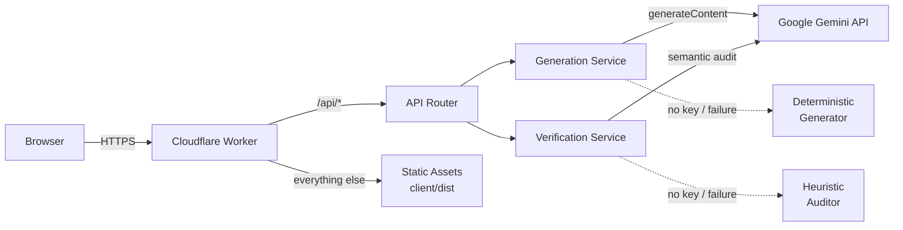
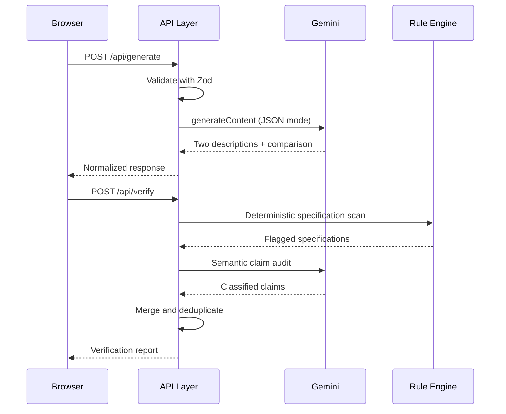
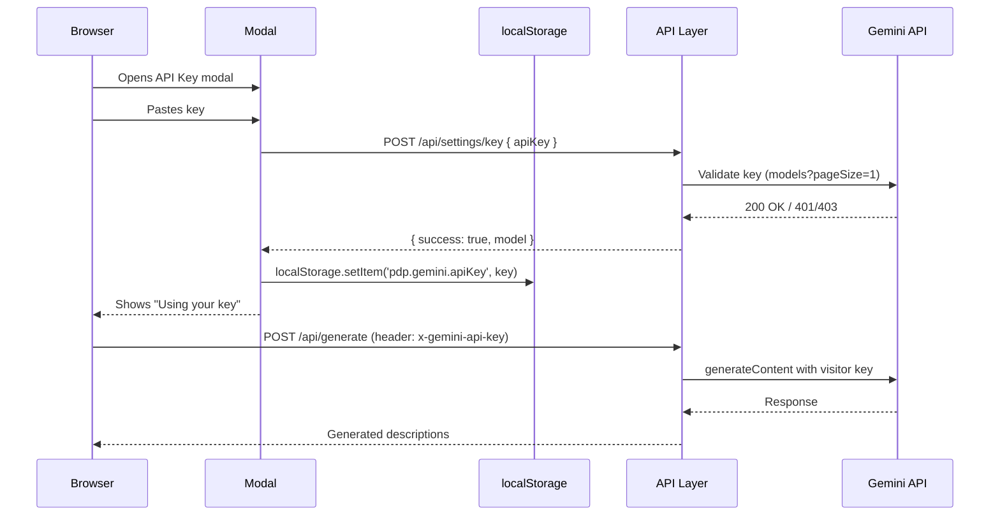

# Product Description Generator

### A Dual-Audience Copy Generation and Factual Verification System

**Project Report**

**Live deployment:** <https://product-description-generator.riishh-work.workers.dev>  
**Source code:** <https://github.com/riishcodes/product-description-generator-project>

---

## Abstract

Product marketing copy is frequently written for a single generic audience, and large language models tend to introduce specifications that were never supplied by the manufacturer. This project presents a web-based system that generates two product descriptions for two distinct target audiences from a shared set of verified product features, compares the messaging strategy between the two outputs, and independently audits every factual claim against the original input.

The system combines a React single-page application, a TypeScript API layer, and Google Gemini models. Generation and verification are separated into independent services so that the verification result is not influenced by the generation prompt. A deterministic rule engine scans for numeric and technical specifications, while a semantic audit extracts and classifies individual claims. The complete application is deployed as a single Cloudflare Worker that serves both the frontend and the API from one origin.

**Keywords:** product copy generation, large language models, hallucination detection, claim verification, Cloudflare Workers, React, TypeScript

---

## Table of Contents

1. [Introduction](#1-introduction)
2. [System Architecture](#2-system-architecture)
3. [Technology Stack](#3-technology-stack)
4. [Functional Modules](#4-functional-modules)
5. [System Design](#5-system-design)
6. [API Reference](#6-api-reference)
7. [Factual Verification Logic](#7-factual-verification-logic)
8. [Local Development](#8-local-development)
9. [Deployment](#9-deployment)
10. [Testing and Results](#10-testing-and-results)
11. [Limitations](#11-limitations)
12. [Future Scope](#12-future-scope)
13. [Conclusion](#13-conclusion)
14. [Appendix](#14-appendix)

---

## 1. Introduction

### 1.1 Problem Statement

Two problems recur in AI-assisted product copywriting:

1. **Audience mismatch.** A single description cannot simultaneously address students, professionals, enterprises, and budget-conscious buyers with the same framing.
2. **Unverified claims.** Language models often add plausible but unsupplied details such as battery life, Bluetooth versions, noise cancellation, warranty periods, or measurements. Publishing these claims creates legal, commercial, and reputational risk.

Existing tools generally optimise for fluency or speed. They rarely provide an independent audit that shows which sentences are supported by the source material and which are not.

### 1.2 Objectives

- Generate two audience-specific descriptions from one set of verified product features.
- Keep every factual claim traceable to the supplied input.
- Compare the messaging, benefits, tone, and positioning of the two outputs.
- Classify claims as `SUPPORTED`, `UNSUPPORTED`, or `NEEDS REVIEW`.
- Provide a responsive interface that works on desktop and mobile.
- Deploy the complete system with no exposed API keys in the browser.
- **Support bring-your-own-key (BYOK)** so visitors can use their own Gemini API key without the operator's key being shared or visitor keys persisted server-side.

### 1.3 Scope

The system covers:

- Product name and feature input
- Two target audiences
- Writing tone and description length
- Dual description generation
- Audience comparison
- Factual claim verification
- Single-audience regeneration
- Copy-to-clipboard and in-session history
- Responsive layout and deployment configuration

The system does not manage product catalogues, publish directly to storefronts, or maintain a persistent user account system.

---

## 2. System Architecture

### 2.1 High-Level Architecture



The production deployment is a single Worker. Static asset requests are served directly by Cloudflare's asset router, while `/api/*` requests are routed to the Worker's `fetch` handler.

### 2.2 Request Flow



### 2.3 Deployment Topology

| Component | Local development | Production |
|---|---|---|
| Frontend | Vite dev server (`:5173`) | Workers Static Assets |
| API | Express (`:5000`) | Worker `fetch` handler |
| API base URL | Vite proxy `/api` | Same origin `/api` |
| Secret storage | `server/.env` | Worker secret |
| Verification runtime | Node.js | Cloudflare Workers |

Because the frontend and API share an origin in production, no CORS configuration or build-time API URL is required.

---

## 3. Technology Stack

| Layer | Technology | Purpose |
|---|---|---|
| Frontend | React 19 | Component-based user interface |
| Frontend | TypeScript 5.7 | Static typing across client and server |
| Frontend | Vite 6 | Development server and production build |
| Frontend | Tailwind CSS 3.4 | Responsive utility-first styling |
| Frontend | Motion | Interface transitions and feedback |
| Frontend | Lucide React | Icon set |
| Backend | Node.js + Express 4 | Local API server |
| Backend | Cloudflare Workers | Production API runtime |
| Backend | Workers Static Assets | Frontend hosting and SPA fallback |
| AI | Google Gemini REST API | Description generation and semantic audit |
| AI models | `gemini-3.5-flash-lite`, `gemini-3.8-flash` | Primary and fallback models |
| Validation | Zod | Request and AI response schemas |
| Testing | Vitest | Unit and integration tests |
| Deployment | Wrangler 4 | Build, secret management, and deployment |

---

## 4. Functional Modules

### 4.1 Input Module

- Product name
- Verified product features, one per line
- Two target audiences with duplicate prevention
- Writing tone: friendly, professional, or persuasive
- Description length: short, medium, or detailed
- Example presets for quick testing

### 4.2 Generation Module

- Produces two descriptions in a single structured request
- Uses a low-temperature JSON-mode prompt
- Validates the model response with Zod before returning it
- Falls back to the next model if the primary model fails
- Falls back to a deterministic generator if no API key is available

### 4.3 Comparison Module

Displays five dimensions for both audiences:

- Messaging differences
- Benefits emphasised
- Positioning summary
- Tone differences
- Audience addressing strategy

### 4.4 Verification Module

- Deterministic scan for numeric and technical claims
- Semantic claim extraction and classification
- Duplicate suppression between rule-based and semantic findings
- Summary banner for `PASSED`, `FLAGGED`, and `WARNING`
- Per-claim evidence and reasoning
- Manual re-verification after regeneration

### 4.5 Productivity Module

- Copy description to clipboard
- Regenerate either audience independently
- In-session history drawer
- Visible error reporting instead of console-only failures
- Responsive navigation drawer on mobile

### 4.6 Security & Key Management (BYOK)

- **Bring-Your-Own-Key (BYOK)**: Visitors enter their own Gemini API key in the settings modal. The key is validated against the Gemini API (`/api/settings/key`), stored in the browser's `localStorage`, and attached to subsequent `/api/generate` and `/api/verify` requests via the `x-gemini-api-key` header.
- **Zero server persistence**: Visitor keys are never written to disk, logged, or stored in any server-side database. Each request carries only the key from that browser's session.
- **Operator fallback**: When no visitor key is present, the app uses the operator's server-side `GEMINI_API_KEY` secret (configured via `wrangler secret put`).
- **No cross-user leakage**: One visitor's key cannot be accessed by another visitor. The operator's key cannot be overwritten via the API.
- **Per-request validation**: The `/api/settings/key` endpoint validates a key against the live Gemini API without storing it, returning `400` for invalid keys and `200` with the model name for valid keys.

---

## 5. System Design

### 5.1 Frontend

The client is a single-page React application. The main dashboard is divided into:

- **Input panel** — product details and generation controls
- **Output panel** — description cards, comparison, and verification report
- **Auxiliary panels** — history, examples, and settings

State is managed locally with React hooks. The interface adapts to mobile through a slide-out navigation drawer, stacked cards, horizontally scrollable tabs, and touch-friendly controls. Form controls use a 16px font size on phones to prevent automatic zoom on iOS.

### 5.2 Backend and API Layer

The API layer is written once and exposed through two runtimes:

- `server/src/server.ts` — Express server for local development
- `server/src/worker.ts` — Cloudflare Worker entrypoint for production

Both use the same route logic, schemas, and services. The Worker handles JSON parsing, validation, error responses, and optional CORS for separately hosted clients.

### 5.3 BYOK Key Flow



The key never touches the server's persistent storage. The `GeminiService` and `VerifierService` accept an optional `apiKeyOverride` parameter per request, which takes precedence over the singleton's operator key.

### 5.3 Generation Pipeline

1. Validate the request with `generateInputSchema`.
2. Build a system prompt that forbids unsupplied specifications.
3. Send the prompt to the primary model in JSON mode.
4. Retry with the fallback model on failure.
5. Validate the response against `aiGeneratedContentSchema`.
6. Compute word counts and return a normalized response.
7. If the model is unavailable, use the deterministic generator.

The deterministic generator constructs audience-aware copy directly from the supplied feature lines. It never introduces specifications that are not present in the input.

### 5.4 Verification Engine

Verification is independent of generation and runs in two stages.

**Stage 1 — Deterministic rule engine**

Regular expressions detect common specification categories, including battery life, battery capacity, Bluetooth versions, active noise cancellation, wireless range, fast charging, IP ratings, audio codecs, warranty periods, driver size, weight, and generic numeric claims. Each detected phrase is compared against the original feature text. Unmatched phrases are marked `UNSUPPORTED`.

**Stage 2 — Semantic audit**

Gemini extracts individual factual claims from both descriptions and classifies each one. If the model is unavailable, a heuristic sentence-level auditor is used instead.

**Stage 3 — Merge and deduplicate**

Rule-based findings take priority. Semantic findings that describe the same issue for the same audience are discarded, preventing the same unsupported specification from being counted twice.

### 5.5 Data Models

```ts
interface GenerateInput {
  productName: string;
  features: string;
  audience1: string;
  audience2: string;
  tone: 'Friendly and engaging' | 'Professional and informative' | 'Persuasive and sales-focused';
  length: 'short' | 'medium' | 'detailed';
  regenerateTarget?: 'audience1' | 'audience2' | 'both';
  existingDescription1?: string;
  existingDescription2?: string;
}

interface VerifiedClaim {
  id: string;
  claimText: string;
  audience: string;
  classification: 'SUPPORTED' | 'UNSUPPORTED' | 'NEEDS REVIEW';
  reason: string;
  isNumericalOrMetric: boolean;
}

interface VerificationReport {
  totalClaims: number;
  supportedCount: number;
  unsupportedCount: number;
  needsReviewCount: number;
  overallStatus: 'PASSED' | 'FLAGGED' | 'WARNING';
  summary: string;
  claims: VerifiedClaim[];
}
```

---

## 6. API Reference

| Method | Endpoint | Description | Availability |
|---|---|---|---|
| `GET` | `/api/health` | Runtime status and active model | All environments |
| `POST` | `/api/generate` | Generate two audience descriptions | All environments |
| `POST` | `/api/verify` | Verify claims against source features | All environments |
| `POST` | `/api/settings/key` | Validate a visitor-supplied Gemini key (BYOK) | All environments |

> **Bring-Your-Own-Key (BYOK)**: Visitors can provide their own Gemini API key via the UI. The key is stored only in the browser's `localStorage` and sent with each request in the `x-gemini-api-key` header. The server validates the key against the Gemini API but **never persists it**. The operator's server-side key is used only as a fallback when no visitor key is present.

### 6.1 Generate Request

```http
POST /api/generate
Content-Type: application/json
```

```json
{
  "productName": "Wireless Headphones",
  "features": "Bluetooth connectivity\nLightweight design\nCushioned ear pads\nBuilt-in microphone",
  "audience1": "Students",
  "audience2": "Working professionals",
  "tone": "Friendly and engaging",
  "length": "short"
}
```

### 6.2 Generate Response

```json
{
  "productName": "Wireless Headphones",
  "description1": {
    "audience": "Students",
    "text": "Description tailored to students...",
    "wordCount": 35
  },
  "description2": {
    "audience": "Working professionals",
    "text": "Description tailored to professionals...",
    "wordCount": 33
  },
  "comparison": {
    "messagingDifferences": "...",
    "benefitsEmphasized": "...",
    "positioningSummary": "...",
    "toneDifferences": "...",
    "audienceAddressingSummary": "..."
  }
}
```

### 6.3 Verify Request

```http
POST /api/verify
Content-Type: application/json
```

```json
{
  "productName": "Wireless Headphones",
  "features": "Bluetooth connectivity\nLightweight design\nCushioned ear pads\nBuilt-in microphone",
  "description1": {
    "audience": "Students",
    "text": "Enjoy Bluetooth connectivity, a lightweight design, cushioned ear pads, and a built-in microphone for classes."
  },
  "description2": {
    "audience": "Working professionals",
    "text": "Stay productive with Bluetooth 5.3, 40-hour battery life, active noise cancellation, and a built-in microphone."
  }
}
```

### 6.4 Verify Response

```json
{
  "totalClaims": 8,
  "supportedCount": 4,
  "unsupportedCount": 3,
  "needsReviewCount": 1,
  "overallStatus": "FLAGGED",
  "summary": "Verification FLAGGED: Detected 3 unsupported or fabricated specification(s) not supplied in original product features.",
  "claims": [
    {
      "id": "det-1-0",
      "claimText": "Specification reference: \"40-hour battery\"",
      "audience": "Working professionals",
      "classification": "UNSUPPORTED",
      "reason": "Deterministic Flag: Introduces unverified Battery Life (\"40-hour battery\"). The original product details do not supply this specification.",
      "isNumericalOrMetric": true
    }
  ]
}
```

### 6.5 Status Codes

| Code | Meaning |
|---|---|
| `200` | Request completed |
| `400` | Validation failure, malformed JSON, or invalid API key |
| `401` | Invalid or rejected Gemini API key (BYOK) |
| `403` | Key update attempted in the hosted deployment |
| `404` | Unknown API route |
| `500` | Generation or verification failure |

---

## 7. Factual Verification Logic

### 7.1 Detected Specification Categories

| Category | Example trigger |
|---|---|
| Battery life | `40-hour battery`, `20 hours of playback` |
| Battery capacity | `5000 mAh`, `90 Wh` |
| Bluetooth standard | `Bluetooth 5.3`, `BT 5.2` |
| Active noise cancellation | `ANC`, `active noise cancelling` |
| Wireless range | `20 metre range`, `range of 30 ft` |
| Fast charging | `fast charging`, `quick charge` |
| Water resistance | `IPX5`, `IP68`, `waterproof` |
| Audio codecs | `aptX`, `LDAC`, `hi-res audio` |
| Warranty | `2-year warranty`, `money-back guarantee` |
| Driver / frequency | `40 mm drivers`, `20 Hz - 20 kHz` |
| Weight | `250 g`, `1.2 kg` |
| Generic numeric claims | Any number with a recognised unit |

### 7.2 Classification Rules

- **`SUPPORTED`** — the claim is explicitly present in the supplied features.
- **`UNSUPPORTED`** — the claim introduces a specification, metric, certification, or capability not present in the input.
- **`NEEDS REVIEW`** — the claim is subjective, contextual, or cannot be confidently verified.

### 7.3 Overall Status

| Status | Condition |
|---|---|
| `PASSED` | No unsupported or review claims |
| `WARNING` | Review claims exist but no unsupported claims |
| `FLAGGED` | At least one unsupported specification |

### 7.4 Example

Input features:

```
Bluetooth connectivity
Lightweight design
Cushioned ear pads
Built-in microphone
```

Generated claim:

```
Stay productive with Bluetooth 5.3, 40-hour battery life,
active noise cancellation, and a built-in microphone.
```

Result: `Bluetooth 5.3`, `40-hour battery`, and `active noise cancellation` are each flagged as `UNSUPPORTED`. The built-in microphone is marked `SUPPORTED`.

---

## 8. Local Development

### 8.1 Prerequisites

- Node.js 20 or newer
- A Gemini API key from Google AI Studio
- npm

### 8.2 Installation

```bash
npm install
npm --prefix client install
npm --prefix server install
```

### 8.3 Environment Configuration

Create `server/.env`:

```env
GEMINI_API_KEY=your_gemini_api_key_here
PORT=5000
GEMINI_MODEL=gemini-3.5-flash-lite
GEMINI_FALLBACK_MODEL=gemini-3.8-flash
CLIENT_ORIGIN=
```

If the key is omitted, the application still runs in deterministic mode.

### 8.4 Running the Application

```bash
# Terminal 1 — API
npm run server

# Terminal 2 — frontend
npm run client
```

Open `http://localhost:5173`. Vite proxies `/api` requests to `http://localhost:5000`.

### 8.5 Running the Production Worker Locally

```bash
npm --prefix client run build
npm run worker:dev
```

Create `.dev.vars` in the project root with `GEMINI_API_KEY=...` before starting. The Worker is available at `http://localhost:8787`.

### 8.6 Testing BYOK Locally

1. Start the local Worker: `npm run worker:dev`
2. Open `http://localhost:8787`
3. Click the API key badge in the header → "Configure your Gemini API key"
4. Paste a valid Gemini key → "Verify & use"
5. The badge changes to "Using your key (AIza...)"
6. Generate descriptions — they will use your key via the `x-gemini-api-key` header
7. To test invalid key handling, paste an invalid key and observe the `400` error

The local Express server (`npm run server`) also supports BYOK via the same header.

---

## 9. Deployment

The application is deployed as a single Cloudflare Worker.

### 9.1 Deployment Steps

```bash
npx wrangler login
npx wrangler secret put GEMINI_API_KEY
npm run deploy
```

`npm run deploy` builds the client and runs `wrangler deploy`.

### 9.2 Worker Configuration

```jsonc
{
  "name": "product-description-generator",
  "main": "server/src/worker.ts",
  "compatibility_date": "2026-11-04",
  "assets": {
    "directory": "./client/dist",
    "binding": "ASSETS",
    "not_found_handling": "single-page-application",
    "run_worker_first": ["/api/*"]
  }
}
```

- `not_found_handling` provides client-side routing fallback.
- `run_worker_first` ensures API requests reach the Worker before the asset router.

### 9.3 Secrets and Configuration

| Variable | Required | Purpose |
|---|---|---|
| `GEMINI_API_KEY` | Yes | Operator's fallback Gemini API key |
| `GEMINI_MODEL` | No | Primary model override |
| `GEMINI_FALLBACK_MODEL` | No | Fallback model override |
| `CLIENT_ORIGIN` | No | Additional CORS origins for split hosting |

Secrets are stored with `wrangler secret put` and are never included in the client bundle or repository.

### 9.4 BYOK in Production

No additional configuration is required for BYOK. The feature works automatically:

- The `x-gemini-api-key` header is allowed via CORS (configured in `worker.ts` and `server.ts`).
- `/api/settings/key` validates visitor keys without persisting them.
- The operator's `GEMINI_API_KEY` secret is used only when no visitor key is present.

The full deployment guide, including custom domains and troubleshooting, is available in [CLOUDFLARE_DEPLOYMENT.md](./CLOUDFLARE_DEPLOYMENT.md).

---

## 10. Testing and Results

### 10.1 Automated Tests

```bash
npm --prefix server run test
```

Result: **12 of 12 tests passing** across two test files.

| Area | Coverage |
|---|---|
| Input validation | Empty product name, missing features, duplicate audiences |
| Generation | Distinct outputs for distinct audiences, word-count accuracy |
| Comparison | All five comparison fields populated |
| Verification | Battery, Bluetooth, ANC, range, fast charging, IP ratings |
| Verification | Supported numeric claims are not flagged |
| Verification | Duplicate findings are merged |

Tests run with a test environment guard, so they never call the live Gemini API or consume API quota.

### 10.2 Build Results

| Artifact | Size |
|---|---|
| Client JavaScript | 317.93 kB (92.76 kB gzip) |
| Client CSS | 41.91 kB (7.67 kB gzip) |
| Worker bundle | 153.08 KiB (28.41 KiB gzip) |
| Worker startup time | ~9–10 ms |

### 10.3 Live Validation

| Check | Result |
|---|---|
| `GET /api/health` | `aiConnected: true`, model `gemini-3.5-flash-lite` |
| `POST /api/generate` | Two distinct descriptions returned |
| `POST /api/verify` | Three unsupported specifications correctly flagged |
| SPA deep link | Returns the application shell |
| Mobile viewport at 390px | No horizontal overflow |
| Browser runtime | No uncaught exceptions |
| API key exposure | Key remains server-side |

### 10.4 Observed Verification Output

For the example input, the verifier produced:

- **Total claims:** 8
- **Supported:** 4
- **Unsupported:** 3
- **Needs review:** 1
- **Overall status:** `FLAGGED`

Flagged items: `40-hour battery`, `Bluetooth 5.3`, and `active noise cancellation`.

---

## 11. Limitations

- **No persistent storage.** History is kept in memory and is lost on page refresh.
- **Rule coverage is finite.** Deterministic checks target common consumer-product specifications; unusual domains may rely more heavily on the semantic audit.
- **Best-effort verification.** The system reduces hallucination risk but does not guarantee legal or regulatory accuracy.
- **No user authentication.** BYOK allows per-visitor keys, but there is no identity system, rate limiting per user, or quota enforcement.
- **Synchronous requests.** Responses are returned after the full model call completes; there is no token streaming.
- **English-oriented prompts and patterns.** Other languages may require prompt and rule adjustments.
- **Free-tier CPU limits.** Gemini calls are network-bound, but heavy traffic may require a paid Workers plan.

---

## 12. Future Scope

- Add authentication and per-user rate limiting.
- Persist history and saved products using Cloudflare D1 or KV.
- Stream generation results to reduce perceived latency.
- Add multilingual prompts and verification rules.
- Expand the specification library for electronics, apparel, food, and cosmetics.
- Add export to CSV, JSON, and storefront formats.
- Introduce a human review workflow for `NEEDS REVIEW` claims.
- Add CI/CD with GitHub Actions and automated deployment checks.
- Support team workspaces and shared brand guidelines.

---

## 13. Conclusion

The project demonstrates that audience-specific product copy and factual verification can be combined in a single, lightweight application without exposing model credentials or maintaining separate hosting for the frontend and API. Separating generation from verification, layering deterministic rules with a semantic audit, and deduplicating findings produces transparent, actionable results rather than a single opaque trust score.

The Cloudflare Workers deployment keeps the operational footprint small: one Worker, one origin, one secret, and no container or Node server to maintain. The same service code runs on Express locally, which keeps development straightforward while preserving a production path that scales with Cloudflare's edge network.

---

## 14. Appendix

### 14.1 Project Structure

```text
product-description-generator/
├── client/
│   ├── public/
│   ├── src/
│   │   ├── components/          # UI components and modals
│   │   ├── constants/           # Example presets
│   │   ├── pages/Home.tsx       # Main dashboard
│   │   ├── services/api.ts      # API client
│   │   ├── types/               # Shared frontend types
│   │   ├── App.tsx
│   │   ├── index.css
│   │   └── main.tsx
│   ├── index.html
│   ├── tailwind.config.js
│   └── vite.config.ts
├── server/
│   ├── src/
│   │   ├── __tests__/           # Vitest suites
│   │   ├── routes/              # Express routes
│   │   ├── schemas/             # Zod schemas
│   │   ├── services/
│   │   │   ├── gemini.ts        # Generation service
│   │   │   ├── geminiClient.ts  # Gemini REST client
│   │   │   ├── verifier.ts      # Verification engine
│   │   │   └── runtime.ts       # Environment helpers
│   │   ├── env.ts               # Node environment loader
│   │   ├── server.ts            # Local Express entrypoint
│   │   └── worker.ts            # Cloudflare Worker entrypoint
│   └── tsconfig.json
├── wrangler.jsonc               # Cloudflare deployment config
├── CLOUDFLARE_DEPLOYMENT.md     # Deployment guide
└── README.md
```

### 14.2 Environment Variables

| Variable | Default | Scope |
|---|---|---|
| `GEMINI_API_KEY` | — | Server / Worker secret |
| `GEMINI_MODEL` | `gemini-3.5-flash-lite` | Server / Worker |
| `GEMINI_FALLBACK_MODEL` | `gemini-3.8-flash` | Server / Worker |
| `PORT` | `5000` | Local Express server |
| `CLIENT_ORIGIN` | — | Optional CORS allow-list |
| `VITE_API_BASE_URL` | `/api` | Client build (split hosting only) |

### 14.3 Example Test Case

| Field | Value |
|---|---|
| Product | Wireless Headphones |
| Features | Bluetooth connectivity, lightweight design, cushioned ear pads, built-in microphone |
| Audience 1 | Students |
| Audience 2 | Working professionals |
| Tone | Friendly and engaging |
| Length | Short (30–50 words) |
| Expected verification | `Bluetooth 5.3`, `40-hour battery`, and `active noise cancellation` are flagged |
